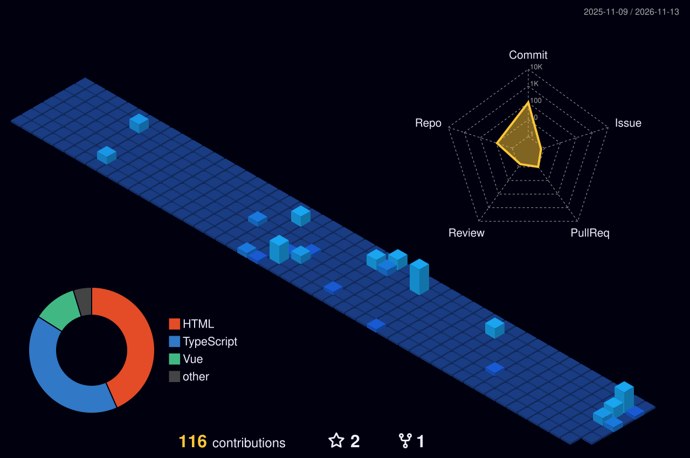

## 👨‍💻 About me

Full-stack software engineer with **5 years** of experience, currently building a complete **ERP system** for a fast-growing e-commerce fashion brand in Malaysia. I started as a frontend specialist (Vue.js, Nuxt, React) and now ship the whole stack — Vue 3 SPAs, Laravel APIs, PostgreSQL, CI/CD and AI-powered automation.

- 🏢 **Software Engineer** at **The Panda Outfit HQ** (Kuala Lumpur) — building Panda ERP end to end
- 🎓 **Master of IT (Research)** at **UniKL** — thesis: *Performance Optimization Techniques for Modern Single Page Applications*

- 🤖 Building **Jarvis**, a bot that runs the ERP's day-to-day automations
- 🧠 Heavy user of **AI-assisted development** (Claude Code, agents) — I curate 150+ AI & dev repos at [claude-ai-repos](https://asif-reachout.github.io/claude-ai-repos/)
- 💼 Freelance on Fiverr as [@webtechcod](https://www.fiverr.com/webtechcod)

## 🚀 Experience

**Software Engineer — The Panda Outfit HQ** · Malaysia · *Jul 2026 – present*

- Building **Panda ERP** from scratch: Vue 3 + PrimeVue SPA, Laravel API, PostgreSQL
- Real-time **TikTok Shop API** integration — order sync, cancellations, shipping and stock for a high-volume shop
- Modules for orders, pick lists, warehouse & production tracking, products/SKUs, HR & payroll, role-based access
- Installable **PWAs** for factory and warehouse counters, web push notifications
- CI/CD with **GitHub Actions** to a Linux VPS (Nginx, queues, staging + production), automated nightly backups to Google Drive

**Senior Frontend Developer — Vlinq** · Lahore, Pakistan · *Oct 2023 – Jun 2026*

- Built a multi-store e-commerce platform, merchant dashboard and themed storefronts (Vue, Nuxt, Quasar, Tailwind)
- Reusable component libraries, performance work (lazy loading, image optimization), internal Chrome extension

**Senior Frontend Developer — Horizam** · Lahore, Pakistan · *Nov 2021 – Oct 2023*

- Responsive web apps with React, Next.js and Bootstrap; reusable, maintainable UI components

## 🧩 Projects

| Project | What it is | Stack | Link |
|---|---|---|---|
| **Panda ERP** | Full ERP for a fashion e-commerce brand — TikTok Shop orders, stock, production, payroll, PWAs | Vue 3 · PrimeVue · Laravel · PostgreSQL | Private (company) |
| **Jarvis** | Automation bot inside Panda ERP — auto-approvals, syncs and background jobs, always online | Laravel queues · Vue 3 | Private · in progress |
| **Claude & AI Repos** | Curated, filterable directory of 150+ AI & dev repos; star counts update daily via GitHub Actions | HTML · JS · GitHub Actions | [Live](https://asif-reachout.github.io/claude-ai-repos/) |
| **VenueBook Pro** | Hall & venue booking app with admin panel and duplicate-booking detection | Vue 3 · Pinia · Supabase · Tailwind | [Live](https://venuebook-pro.netlify.app) · [Code](https://github.com/asif-reachout/venuebook-pro) |
| **TradeBot** | Personal trading automation bot | — | Private |
| **Vlinq Sitemap Opener** | Chrome extension that loads, searches and opens 5,000+ store URLs | JavaScript · Chrome APIs | [Code](https://github.com/asif-reachout/vlinq-stores-extension) |
| **Smart URL Shortener** | Glassmorphism URL shortener SPA | JavaScript · PHP · MySQL | [Code](https://github.com/asif-reachout/Smart-url-shortener) |

## 🏙️ My contributions, as a city

## 📫 Connect

[GitHub](https://github.com/asif-reachout) ·
[LinkedIn](https://linkedin.com/in/asif-reachout) ·
[Portfolio](https://asifcode.netlify.app) ·
[Email](mailto:asif.reachout@gmail.com) ·
[Fiverr](https://www.fiverr.com/webtechcod) ·
[AI Repos](https://asif-reachout.github.io/claude-ai-repos/)

keep coding, keep growing.

